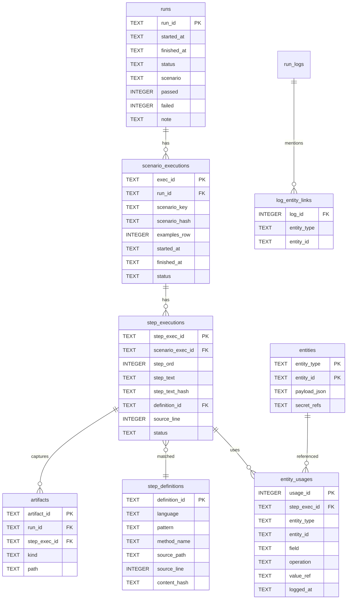

**Linked Tracking Design (Pickleball 3.0.0)**

**Start SHA:** `f326cb2b7cd59da7667aef966c303f2a12ab1f28` (origin/3.0.0 tip when implementation started). Design was written at `a03e43c01cadfce33a2e1bef877c2117676678be`.

**Subsystem:** Dalton linked data model + tracking dashboard + timeline
**Status:** SCHEMA_VERSION 6 is implemented. Hydrate upserts `step_definitions` from Java `@Given`/`@When`/`@Then`/`@And`/`@But` string literals under `src/main/java` and `src/test/java`, and from `Given`/`When`/`Then`/`And`/`But`/`defineStep` calls under `glue/js` (`.js` and `.ts`, source only). A tracked run records `scenario_executions` and `step_executions` and sets `definition_id` when the step text matches a catalog pattern. A lookup during that step records `entity_usages` (`read`) with a masked `value_ref`. `dalton entity use` records `write` or `mention`. `dalton history record --link=Type#id` writes `log_entity_links` from that argument, not from the message text. `dalton history record --from` links screenshot files under that diagnostic directory and does not delete or rewrite the report. `dalton query` and `dalton timeline` read those rows in SQL, including tag, feature, run, text, cursor, before, and latest. `--feature` keeps step and usage rows whose scenario key contains that path. `--tag` keeps step and usage rows for a scenario whose tags match, by file path and scenario line, and a Scenario Outline example row still belongs to that outline. An Examples tag matches only that Examples block, from its Examples line to the next Examples block or the next scenario. A feature tag matches every scenario in that file. A log row stores the run's scenario name, not a scenario path, so a tag or feature filter does not keep it by key. A blank scenario name is stored blank and is not replaced with the scenario key, so a tag or feature filter still does not keep that log row. A timeline run row stays when that run touched a match, because a run row has no scenario path. `total` is the full filtered count on every page, including `--cursor`. `dalton retain` deletes old runs and their executions, usages, log links, and artifacts. `step_definitions` and report files stay. `pkb_dalton_log=track` records catalog, execution, usage, link, artifact, and timeline lines. The Workbench Tracking tab forwards those commands, opens the newest page, and jumps into the existing Explorer or shows a gap when that run is not in the catalog. Rewind is view-only over recorded history. It does not undo browser or service side effects. A schema 4 or schema 5 database upgrades in place and keeps its rows.

---

### Purpose

Extend Dalton so every logically related record is joined by real keys (not free text). Provide a queryable/filterable tracking dashboard for scenarios, steps, step definitions, runs, executions, logs, artifacts, and business entities. Provide a timeline that can rewind/fast-forward over recorded history (view-only). Reuse existing Explorer player instead of building a second one. CLI-first. Workbench/MCP/Gradle forward only. DB stays gitignored. Secrets never cleartext.

Branch docs (AGENTS.md, 3.0.0-dalton-design.md, dalton-entities.md) win over this prompt where they disagree. The working copy is SCHEMA_VERSION 6, upgraded in place from 5. The DDL below is what `DaltonDatabase` creates.

### Data Model (SCHEMA_VERSION = 6)

In-place upgrade from 5. Existing tables remain. New tables and FKs:



**DDL (new tables; existing unchanged)**

```sql
CREATE TABLE IF NOT EXISTS step_definitions (
  definition_id TEXT PRIMARY KEY,
  language TEXT NOT NULL,
  pattern TEXT NOT NULL,
  method_name TEXT,
  source_path TEXT NOT NULL,
  source_line INTEGER NOT NULL,
  content_hash TEXT NOT NULL,
  hydrated_at TEXT NOT NULL
);

CREATE TABLE IF NOT EXISTS scenario_executions (
  exec_id TEXT PRIMARY KEY,
  run_id TEXT NOT NULL REFERENCES runs(run_id) ON DELETE CASCADE,
  scenario_key TEXT NOT NULL,
  scenario_hash TEXT NOT NULL,
  examples_row INTEGER,
  started_at TEXT NOT NULL,
  finished_at TEXT,
  status TEXT NOT NULL,
  passed INTEGER NOT NULL DEFAULT 0,
  failed INTEGER NOT NULL DEFAULT 0
);

CREATE TABLE IF NOT EXISTS step_executions (
  step_exec_id TEXT PRIMARY KEY,
  scenario_exec_id TEXT NOT NULL REFERENCES scenario_executions(exec_id) ON DELETE CASCADE,
  step_ord INTEGER NOT NULL,
  step_text TEXT NOT NULL,
  step_text_hash TEXT NOT NULL,
  definition_id TEXT REFERENCES step_definitions(definition_id),
  source_line INTEGER,
  started_at TEXT NOT NULL,
  finished_at TEXT,
  status TEXT NOT NULL
);

CREATE TABLE IF NOT EXISTS entity_usages (
  usage_id INTEGER PRIMARY KEY AUTOINCREMENT,
  step_exec_id TEXT NOT NULL REFERENCES step_executions(step_exec_id) ON DELETE CASCADE,
  entity_type TEXT NOT NULL,
  entity_id TEXT NOT NULL,
  field TEXT,
  operation TEXT NOT NULL,
  value_ref TEXT,
  logged_at TEXT NOT NULL
);

CREATE TABLE IF NOT EXISTS log_entity_links (
  log_id INTEGER NOT NULL REFERENCES run_logs(id) ON DELETE CASCADE,
  entity_type TEXT NOT NULL,
  entity_id TEXT NOT NULL,
  PRIMARY KEY (log_id, entity_type, entity_id)
);

CREATE TABLE IF NOT EXISTS artifacts (
  artifact_id TEXT PRIMARY KEY,
  run_id TEXT REFERENCES runs(run_id) ON DELETE CASCADE,
  step_exec_id TEXT REFERENCES step_executions(step_exec_id) ON DELETE SET NULL,
  kind TEXT NOT NULL,
  path TEXT NOT NULL,
  retained_at TEXT NOT NULL
);
```

**ID Strategy**
- step_definitions.definition_id = SHA-256(language + '|' + pattern + '|' + source_path + '|' + source_line)
- scenario_executions.exec_id = run_id + '|' + scenario_key + '|' + (examples_row or '')
- step_executions.step_exec_id = scenario_exec_id + '|' + step_ord + '|' + step_text_hash
- scenario_key = file_path + '|' + ord (stable across rehydration)
- Hashes are content hashes of the version that actually ran (so history stays correct after file edits)
- Executions reference the definition_id and hashes of what was matched/run

**Capture Points (minimal overhead)**
- On hydrate or glue fingerprint change: upsert step_definitions from Java annotations (GlueRules) and JS/TS step definitions if present under glue/js/. `definition_id` stays SHA-256(language|pattern|source_path|source_line). A line move remaps `step_executions.definition_id` to the single new id for the same language, pattern, and path. Unreferenced leftovers are deleted. A leftover that executions still reference is marked `removed` and is omitted from the catalog list.
- On a tracked run (`pkb_dalton_track` truthy, or `pkb_run_id` set while track is unset, and Dalton enabled): each step writes one `scenario_executions` row and one `step_executions` row in `pkb_dalton_project` when that property is set. `definition_id` is the longest matching catalog pattern (exact text, then `{param}` placeholders, then a `^` or `/regex/` pattern). An explicit falsy `pkb_dalton_track` writes nothing. A tracking failure does not fail the scenario. Each run id is `yyyyMMdd-HHmmssZ` plus an 8-character suffix, the same shape as a diagnostic run id, unless the caller already set `pkb_run_id` or a diagnostic run is already active. Each top-level in-process `PickleballEngine.run` mints that id and clears a self-minted id when the call returns. A nested run stays on the outer id. The native API closes the tracked scenario with that scenario's status when the scenario finishes. A suite run still finishes once, with the plugin status. Scenario Outline rows store the 1-based `examples_row`, and that value is part of `exec_id`. A Cucumber engine run records through `DaltonRunTrace` whenever Dalton is on. The native engine records from the native step. `pkb_dalton_run_trace` is only the warm-worker outcome file. An auto-hydrate failure prints `error:` and `fix: dalton hydrate` and stops the feature load.
- On `<entity:Type#id.field>` resolution (`DaltonEntities.lookup`) while `DaltonRunContext` is active: insert `entity_usages` with operation `read`. `value_ref` is `<password:qaDb>`, `~MASK;`, or `<entity:Type#id.field>`, never the resolved cleartext. No active step means lookup does not open a database. `dalton entity use` records `write` or `mention` on `--step` or the active step.
- Additive public API or step hook (new step allowed only if additive, existing annotations unchanged): log entity usage explicitly (write/mention)
- Structured `--link=Type#id` arguments on `dalton history record` insert `log_entity_links`. The message text is not scanned.
- Screenshot files under a diagnostic directory passed to `--from` are linked in `artifacts`. The report files stay on disk. `dalton history retain` deletes database rows only.

**CLI Surface (CLI-first)**
- `dalton query --entity=Type#id [--field=...] [--from=ISO] [--to=ISO] [--status=] [--tag=] [--feature=] [--run=] [--text=] [--json] [--limit=N] [--offset=N]`
- `dalton query --step-def=<definition_id> [--status=FAILED] [--json]`
- `dalton query --scenario=<key> [--json]`
- `dalton timeline --from=ISO --to=ISO [--entity=...] [--tag=] [--feature=] [--run=] [--text=] [--json] [--cursor=] [--before=] [--latest]` (ordered event stream of runs, steps, usages, logs, and artifacts; filters and the page limit run in SQL)
- `dalton retain --days=N --max-bytes=N` (same retain as `dalton history retain`; deletes old runs and the child rows; `step_definitions` stay)
- `--json` stable key order, pagination
- Workbench Tracking view (or Dalton tab extension) and MCP tools only forward to these CLI commands. Never open SQLite or use Dalton classes directly.

**Dashboard UX**
- CLI is primary. Example queries: every run/step/log that touched Case#123; failures of step definition X in last 7 days; scenarios using entity type Account; filters by tag, feature, status, date, run, entity, step def, free-text log search (structured where possible).
- Workbench: Tracking panel that shells out via `DaltonCliForwarder`. There is no separate HTML dashboard.

**Timeline UX**
- CLI exposes ordered event stream.
- Workbench Timeline lists events over time and opens on the newest page. Older and Newer page through `--before` and `--cursor`. From/To and tag, feature, run, and text filters are forwarded. Scrub, Previous/Next, play/pause, and speed walk beats inside the loaded page. Selecting a run jumps into the existing Explorer player for that one diagnostic run (reuses events.jsonl scrubber/play/speed). When the catalog has no matching run, Explorer shows the gap `No retained diagnostic run matches <id>`. A blank run id shows `Select a run with a run id first`. An Explorer that is not ready shows `Explorer is not ready`. No second player. Retain forwards `dalton retain`.
- Explicit UI and docs note: "Rewind is view-only over recorded history. It does not undo browser or service side effects."

**MCP**
- Existing `dalton` MCP tool extended, or new tools that forward to `dalton query` / `dalton timeline` / `dalton retain`. No direct DB access.

**Retention and Size**
- Runs, executions, logs, artifacts, and usages are date-stamped. `dalton retain` deletes `runs` older than `--days` and then the oldest runs until the note, scenario, and log-message bytes fit `--max-bytes`. Child executions, usages, log links, and artifacts follow `ON DELETE CASCADE`. `step_definitions` stay. Diagnostic report files stay. The database is never committed. A fresh clone or CI works with no database.

**Secrets**
- Never store cleartext secret values in any new table, log, timeline, or dashboard. value_ref holds only references (`<password:qaDb>`) or `~MASK;`. Existing DaltonSecrets rules apply. High-entropy warnings stay.

**Upgrade Path**
- Bump SCHEMA_VERSION to 6. In-place `addColumn` / CREATE IF NOT EXISTS. Test starts from a schema 5 DB and verifies upgrade + existing rows preserved.

**Rejected Alternatives**
- Free-text joins or regex extraction from log messages for entity links
- Separate timeline player that duplicates Explorer
- Workbench opening SQLite or importing Dalton classes
- Changing existing Gherkin syntax or step annotation strings
- Making DB required for CI or committing it
- Storing cleartext secrets

**CLI-first and Logging Checklist (every phase)**
- CLI command exists and is documented
- Workbench action forwards to CLI
- MCP tool forwards to CLI
- Gradle task (if any) forwards to CLI
- Logging toggleable, per-entity, ISO date-stamped, size-capped following `pkb_dalton_log` / DaltonLog pattern. Linked tracking uses capability `track`.
- Existing tests pass; Dalton-off path unchanged

**Honesty**
Rewind is a view over recorded history only. It does not reverse side effects. Document this in UI labels, tooltips, and this design.
