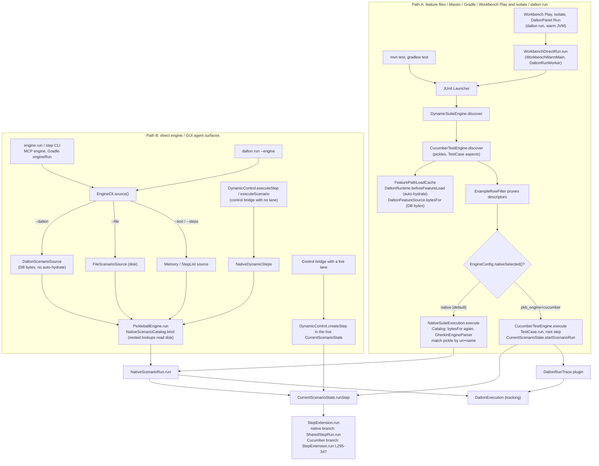

# Execution-path audit (2026-11-15)

**Audited SHA:** `defc3c5199152def5cce6919bc8286d7381e9b5e` (`origin/3.0.0`, "Record a native step before AFTER_STEP runs later ones.")
**Kind:** read-only analysis. This file records findings and recommendations. It does not describe implemented behavior and nothing here changes product code. Where this file and `AGENTS.md` or the guides disagree about behavior, the guides and the code win. This file only reports what the code at the audited SHA does.
**Method:** I read `AGENTS.md`, `docs/agent/feature-map.md`, `docs/maintainer/3.0.0-engine-design.md`, `docs/maintainer/3.0.0-dalton-design.md`, `docs/release-notes.md` and `gradle.properties`, then traced each entry point in source. No build or test was run. Line numbers are at the audited SHA. Items marked **(suspected)** or **(uncertain)** come from reading the code only and need a targeted test before anyone acts on them.

Severity: **High** means behavior can differ from what the docs or the user expect. **Medium** means duplication or cost that is likely to drift or slow runs. **Low** means cleanup.
Effort: **S** is low-hanging (local, about a day). **M** touches a few classes. **L** is structural.

## 1. Questions and short answers

| # | Question | Answer |
|---|---|---|
| Q1 | Is execution streamlined, with no repeated logic? | **No, not fully.** The step body, scenario envelope, status mapping, examples-map install, step-registry build, Gherkin post-processing and feature loading each exist in two to four copies. Details are in sections 3 and 4. |
| Q2 | Does everything run off the Dalton hydrated model on both trigger paths? | **Partly.** With Dalton on, the JUnit/Workbench/`dalton run` path reads hydrated feature **bytes** from `.pickleball/dalton/dalton.db` for top-level and nested lookups. The direct engine path reads disk files for `engine run --file` and for every nested `SCENARIO`/`COMPONENT`/`CALL`/`RUN` lookup, and it reads in-memory text for `--text`, `--steps`, MCP `engine` and `DynamicControl`. No path executes from the projected Dalton rows (`scenarios`, `steps`). Every path re-parses raw bytes. Inside a native suite run, nested scenarios run on Cucumber pickles, not on the engine model. See section 2. |
| Q3 | What low-hanging fruit is there, especially around run variables? | The run id lives in JVM system properties, the runner value map, the diagnostic reporter and agent coordination. Scenario state lives in `ExecutionContext` and in `CurrentScenarioState`, and some of the `ExecutionContext` fields are written but never read. Per-run statics (`LOG_LEVEL`, `PKB_props.features`) are mutated in place. See F5, F7 and F8. |
| Q4 | Where do the two trigger paths converge and diverge? | They converge at `NativeScenarioRun` → `CurrentScenarioState.runStep` → `StepExtension` / `SharedStepRun`, and at `DaltonExecution` for tracking. They diverge in loading, selection, nested lookup, suite and scenario hooks, plugin events and run-id handling. See section 2 and the diagram. |

## 2. Trigger paths (Q2, Q4)

### 2.1 Where each entry point gets its scenario and step model

| Entry point | Feature bytes | Model executed | Nested SCENARIO/COMPONENT/CALL/RUN lookup | Evidence |
|---|---|---|---|---|
| JUnit suite, native (default): `mvn test`, Workbench Play/isolate, `dalton run` | Dalton DB bytes when Dalton is on (`FeaturePathLoadCache.parseResource` L84-111 → `DaltonFeatureSource.bytesFor` L21-40). Auto-hydrate runs at the first load (`FeaturePathLoadCache` L88, L115 → `DaltonRuntime.beforeFeatureLoad` L15-33). | Cucumber discovery builds pickles. `NativeSuiteExecution.Catalog` then reads the bytes **again** (`read` L361-382, `bytesFor` at L363), re-parses them with `GherkinEngineParser` (L350) and maps each pickle to an `EngineScenario` by `uri + name` (L334-340). If nothing matches it falls back to `fromPickle` (L384), so it runs a model converted from the pickle. | `NativeScenarioCatalog` is not bound on this path (`bind` is only called at `PickleballEngine.java:54`), so `ModularScenarios.collectMatches` takes the Cucumber branch (`ModularScenarios.java:676-719`): `CucumberScanUtil.listPickles` → `FeaturePathFeatureSupplier_Cache.aj` → `FeaturePathLoadCache` (Dalton bytes). The nested scenario is materialized from the **Cucumber pickle** (`prepareScenarioStep` L922-935), not from the engine model. | as listed |
| JUnit suite, `pkb_engine=cucumber` | Same Dalton bytes. | Cucumber pickles through the `TestCase` constructor aspect (`TestCase_Constructor_StepExtensionsRewrite.aj` L44-83) and the root step (`GeneralSteps.java:160-164` → `CurrentScenarioState.startScenarioRun` L226). | Same Cucumber branch (Dalton bytes). | as listed |
| `engine run --dalton`, `dalton run --engine` (`DaltonCli.java:189-199`) | DB bytes through `DaltonQuery` (`DaltonScenarioSource.java:28-41`). **No auto-hydrate on this path.** `DaltonRuntime.beforeFeatureLoad` has only the two `FeaturePathLoadCache` callers, so a stale database runs as it is (uncertain whether that is intended). | `GherkinEngineParser` model. | `NativeScenarioCatalog.features` → `resolve` / `loadFile` → `FileScenarioSource` (**disk**, `NativeScenarioCatalog.java:79-110`). A DB-only edit to a component or call feature is not seen. | as listed |
| `engine run --file`, MCP `engine` with `--file` | **Disk** (`EngineCli.java:116`, `FileScenarioSource.java:18-37`), even when Dalton is on. | `GherkinEngineParser` model. | Disk (as above). | as listed |
| `engine run --text/--steps`, MCP `engine`, `DynamicControl.executeScenario`, `executeStep` with no scenario on the thread | In-memory text (by design: "nothing on disk"). | `GherkinEngineParser` model or a single `EngineStep`. | `executeScenario` → `PickleballEngine.run` → disk catalog. Single steps have no nested catalog unless one is already bound. | `NativeDynamicSteps.java:40-101`, `PickleballEngine.java:32-39,84-97` |
| Control bridge with a live lane (paused scenario) | Whatever loaded the live scenario (path A). | Live `StepExtension` in the running `CurrentScenarioState`. | Same as the live scenario. | `DynamicControl.java:94-104,146-160` |
| Workbench GUI, MCP `dalton`/`engine`/`domengine` | The Workbench only forwards argv to the core CLIs (`EngineCliForwarder`, `DaltonCliForwarder`, `WorkbenchMcpTools.java:397-406`). It loads no model itself, which matches the AGENTS.md boundary. | n/a | n/a | as listed |

**The Q2 answer in one line:** the feature-file and Workbench-run paths execute hydrated bytes, top-level and nested. The direct engine path executes hydrated bytes only for top-level `--dalton` and uses disk for `--file` and for all nested lookups. No path executes the projected Dalton rows. That last point matches the design rule "Git files stay the source of truth".

## 3. Findings (ranked)

### F1. Native scenarios skip the scenario-level lifecycle and reporting envelope. High, S-M.

- On the Cucumber path, `CurrentScenarioState.startScenarioRun` (L226-) does the following: `Stagger` (L228), the per-scenario ReportPortal and HTML converters (L232-233), `lifecycle.fire(BEFORE_SCENARIO_RUN)` (L245), `ReportingSteps.setRow` "Started" (L247-249), the examples map (L274-278), `AFTER_SCENARIO_PASS`/`AFTER_SCENARIO_FAIL` (L287-293), the final report row (L320-322), `completeScenarioLogging` (L328), `AFTER_SCENARIO_RUN` (L334), `scenarioRunCleanUp` (L340) and `AFTER_SCENARIO_CLEANUP` (L346).
- On the native path, `NativeScenarioRun.run` does not call `startScenarioRun`. It builds its own plain `scenarioLog` (`NativeScenarioRun.java:89`), installs examples itself (L283-292), and calls only `state.scenarioRunCleanUp()` (L191-196). `grep` finds no `lifecycle.fire(BEFORE_SCENARIO_RUN|AFTER_SCENARIO_*)` under `tools.dscode.engine`. Only the step phases are shared (`SharedStepRun.java:195,225`).
- The consumer project registers `@LifecycleHook(Phase.AFTER_SCENARIO_CLEANUP)` (`maven-consumer-project/src/test/java/com/example/pickleball/PickleballTests.java:70-73`). That hook calls `Release216Steps.afterScenarioCleanup` (L135-), which asserts that registered-object cleanup ran. Under the default native engine, that hook and its assertion never run, so the guard is vacuous on native. This is a static reading only. Confirm it with a targeted native test.
- AGENTS.md (Execution engine) and the release notes claim suite-hook parity only ("the same suite hooks and suite finish"). Scenario-hook parity is not claimed and not delivered.
- **Recommendation:** split `startScenarioRun` into `openScenario(...)`, `runBody(...)` and `closeScenario(...)`, and have `NativeScenarioRun` call the open and close halves. Add one native test that asserts `BEFORE_SCENARIO_RUN`, `AFTER_SCENARIO_PASS`/`FAIL`, `AFTER_SCENARIO_RUN` and `AFTER_SCENARIO_CLEANUP` fire once each, in order. If any phase is meant to stay adapter-only, say so in AGENTS.md.

### F2. Native suite maps pickles to engine scenarios by `uri + name`. Suspected wrong outline row when rows are filtered. High, S.

- `NativeSuiteExecution.Catalog.load` parses the **whole** file into a FIFO queue keyed by `uri + "\n" + scenarioName` (L342-358). `take(pickle)` pops the head of that queue (L334-340) and checks nothing else, neither the line nor the example row.
- `ExampleRowFilter.applyToDiscoveredSuite` removes unselected rows from the JUnit tree (`removeFromHierarchy` at ExampleRowFilter L103, L132, L218), and `walk` only visits the remaining TEST nodes (L139-146). The Catalog still holds every row.
- An outline whose name has no `<placeholder>` gives every row the same name (`GherkinEngineParser.interpolateName` L174-185). If `pkb_example`, an Examples-block tag or a line filter keeps a later row, that row's pickle pops the first row's `EngineScenario`. The first row's `exampleValues` then get installed (`NativeScenarioRun.installExamples` L283-292). The Workbench "play one example row" flow hits exactly this case. **(suspected)** I found no test that names `NativeSuiteExecution`.
- **Recommendation (S):** key by pickle location. Use the pickle line (the Examples row line for an outline row) against an `exampleLine` metadata value stamped by `GherkinEngineParser.expand`, or remove the matched entry by line instead of FIFO. Add a native test with three same-named rows and `pkb_example=2`.

### F3. Each feature is loaded and parsed at least twice per native suite run, and the Dalton DB is reopened each time. Medium, S (cache) / L (native discovery).

- Discovery parses through `FeaturePathLoadCache` (Dalton bytes, Cucumber parser plus the aspects `PickleCompilerAugment.aj`, `ForceNullValuesRowAspect.aj` and `EncodingParserLineSwap.aj`). Then `NativeSuiteExecution.Catalog` calls `DaltonFeatureSource.bytesFor` again (L363) and re-parses with `GherkinEngineParser` plus `EncodingRewrite` (L350). AGENTS.md says `EncodingRewrite` "repeats the encoding line swap", so two post-processing implementations must stay byte-identical, and only the parity tests guard that.
- `DaltonFeatureSource.bytesFor` opens a new `DaltonDatabase` on **every** call (L27). `DaltonDatabase.open` takes a per-file lock and runs `configure()` plus `migrate()` on each open (`DaltonDatabase.java:53-59`). `cacheSuffix()` opens it again (L50). The parallel first-pass parse (`FeaturePathLoadCache.parseAll` L203-220) therefore serializes on that lock for each file. `DaltonScenarioSource.load` does N+1 opens through `DaltonQuery.features` and then `DaltonQuery.file` for each feature (L31-33).
- The native comment at `NativeSuiteExecution.java:87-89` says discovery also builds Cucumber `TestCase`s. Each one runs `resetCommonMaps()`, builds `StepExtension`s and a `CurrentScenarioState` (`TestCase_Constructor_StepExtensionsRewrite.aj` L57-81), and the native run then throws them away. **(uncertain)** I did not trace exactly where discovery constructs them.
- **Recommendation (S):** keep one read-only snapshot per `hydration_id`, a `uri → bytes` map loaded in one query, inside `FeaturePathLoadCache`. Have `NativeSuiteExecution.read` and `DaltonScenarioSource` use it. Skip `migrate()` on read-only opens after the first one in a JVM. **(L)** Longer term, a native discovery that builds `EngineScenario`s directly would remove the second parse and the Catalog matching (F2) together.

### F4. The direct engine path is not on the hydrated bytes for `--file` and nested lookups, and `--dalton` neither defaults on nor auto-hydrates. Medium, S-M.

- Evidence is in table 2.1: `EngineCli.java:111-120`, `FileScenarioSource.java:18-37`, `NativeScenarioCatalog.java:79-110`, `DaltonScenarioSource.java:28-41`.
- The release notes say that with Dalton on "a database-only edit changes the scenario and step text that run". That holds on path A but not for `engine run --file`, MCP `engine`, `DynamicControl.executeScenario` nested lookups, or any `SCENARIO`/`COMPONENT`/`CALL` reached from a `PickleballEngine.run` call.
- **Recommendation:** (S) have `FileScenarioSource` and `NativeScenarioCatalog.loadFile` read through `DaltonFeatureSource.bytesFor` (or the snapshot from F3) when Dalton is on, the same as `NativeSuiteExecution.read`. (S) Call `DaltonRuntime.beforeFeatureLoad()` from `DaltonScenarioSource.load`. (Needs a decision from Dan) Decide whether `engine run --file` should prefer DB bytes by default when Dalton is on. That is a CLI contract change.

### F5. The run id and tracking state have several sources of truth and live in JVM globals. Medium, S-M.

- `pkb_run_id` is read and written as a **JVM system property** by `DaltonExecution` (L274, L333-349 `RunLease`, L363-375 `runId()`), `AgentCoordination` (L231, L434, L454, L463-464) and `WorkbenchLaunchTiming` (L80). `PickleballRunner.values` (`PickleballRunner.java:211`, read through `PKB_props.get`) and `DiagnosticReporter` (L1107-1115) keep their own copies.
- `RunLease` is documented as "one top-level `PickleballEngine.run`", but it mutates process-wide state from one thread. Two concurrent top-level API runs, for example two MCP or control calls in one worker, would overwrite or clear each other's id. **(uncertain)** I did not check whether such concurrency happens in practice.
- `DaltonExecution.runId()` mints an id and leaves it set (L372-373). `shouldTrack()` then treats any set `pkb_run_id` as "track" (L274-275), so a self-minted id persists for the rest of that JVM. `WorkbenchDirectRun.apply` clears `pkb_*` before each warm launch (L92-94), which limits this to non-Workbench JVMs.
- `shouldTrack` (L265-276) and `trackingWithoutRunId` (L353-361) parse `pkb_dalton_track` twice.
- With tracking on, each step opens SQLite twice, in `beforeStep` (L144) and `afterStep` (L179), plus once more at scenario finish (L248). Every open runs `configure` and `migrate`.
- **Recommendation:** add a single `RunIdentity` resolved once per top-level run (caller id → diagnostic id → minted), carried on `ExecutionContext` or the runner and inherited by worker threads. Write the system property only for child processes that need `-D`. Keep one connection in the `Active` tracking record for the life of a scenario.

### F6. The step body, status mapping, examples install and registry build are duplicated. Medium, S-M.

- **Step envelope:** the Cucumber branch of `StepExtension.run` (`StepExtension.java:295-347`) and `SharedStepRun.run` (`SharedStepRun.java:186-230`) both create the step log entry, fire `BEFORE_SCENARIO_STEP`, execute, wait for page ready, fire `AFTER_SCENARIO_STEP` and close the entry. They differ in parent-entry lookup (`getParentEntryForStep` vs `closestEntryToScenario`), log-level elevation for `BLOCK_CONDITIONAL`/`DEBUG_LOGGING` (L316-320, Cucumber only) and finalization (`finalizeStepEntryLogging` vs `stepEntry.stop()`). Those differences are where parity drift starts.
- **Status mapping, four copies:** `NativeSuiteExecution.pluginStatus` (L191-212) and `stepStatus` (L546-556), `NativeScenarioRun.map` (L446-456), and `CucumberModelConverter.toStatus`/`toCucumberStatus` (L50-72). Only the last one is the documented adapter edge.
- **Pickle-to-engine conversion, two copies:** `NativeSuiteExecution.fromPickle` (L384-) for `io.cucumber.core.gherkin.Pickle` and `CucumberModelConverter.fromPickle` (L256-) for message `Pickle`.
- **`source=runtime` message stamping, two copies:** `PickleballEngine.finish` (L117-126) and `NativeScenarioRun.toResult` (L408-413).
- **Examples NodeMap install, four copies:** `CurrentScenarioState` L274-278, `NativeScenarioRun.installExamples` L283-292, `NativeModularRun.materialize` L41-47 and `ModularScenarios.prepareScenarioStep` L931-935.
- **`StepRegistry` built fresh by classpath scan in four places:** `PickleballEngine.run` L43-52, `PickleballEngine.registry` L99-111, `NativeSuiteExecution.registry` L298-314 and `NativeDynamicSteps.registry` L104-108. `NativeDynamicSteps.execute` builds one registry to check for UNDEFINED (L56). It then calls `PickleballEngine.runStep` without a `registry` resource (L61-63), and that call scans `tools.dscode.coredefinitions` again (L99-111). That is two scans per dynamic step.
- **Two glue systems in one native run:** `StepRegistry` handles native matching, and a reflectively built Cucumber `Runner`/`CachingGlue` (`NativeSuiteExecution.ensureCachingGlue` L247-275) handles nested service calls and pickles.
- **Recommendation:** (S) keep one status mapper (`CucumberModelConverter`), one `ExampleMaps.install(parsingMap, headers, values)`, one `StepResults.withSource(...)`, and a `StepRegistries.forGlue(List<Class<?>>)` cache keyed by glue set. Pass the registry through the `context.resource("registry")` that `PickleballEngine.registry` already honors. (M) Extract a `StepEnvelope.run(step, body)` used by both `StepExtension` branches.

### F7. Scenario state has more than one container, and the "is a Cucumber scenario live?" test is answered three ways. Medium, M.

- `ExecutionContext` keeps `stepStack`, `scopes` and `failures` (L43-47). `NativeScenarioRun` writes them (`pushStep` L122, `popStep` L152, `fail` L114/L136/L189/L200, `scope().put("returned")` L156). In production code nothing reads `failures()`, `stepStack()`, `pushScope()`/`popScope()`, `elapsed()` or the `"returned"` scope key. Only `ExecutionContextTest` reads them. The real source of truth is `CurrentScenarioState` (`stepFailures`, `recordHardFailure`, `isScenarioFailed`).
- The native path also fakes Cucumber state: `GlobalState.installNativeTestCase` builds a reflective `TestCase`/`TestCaseState` in `GlobalRegistry.LOCAL` (L166-185), and `replaceForTopLevelRun` removes it again for the adapter (L116-125). That is a third container that exists only for compatibility.
- The three liveness checks are `GlobalState.cucumberScenarioLive()` (L270-273: thread local plus `testCase`), `GlobalState.getCurrentScenarioState() == null` (used by `DynamicControl` L45, L95, L118, L154, L353) and `GlobalState.getTestCase() != null` (`DynamicControl.executeScenario` L134, `ModularScenarios.collectMatches` L677).
- `RunBindings.scenarioState` has a four-step fallback (L36-48). The last step, `ExecutionContext.legacyOrNull()`, repeats the second step whenever `of(null)` was used.
- Per-scenario resets are split. The Cucumber side uses aspects (`TestCase_Constructor_StepExtensionsRewrite.aj` L57 `resetCommonMaps`, `TestCase_ScenarioObjectScope.aj` `clearScenarioObjects`). The native side calls them directly (`NativeScenarioRun.java:58-60,67,202`, `ExecutionContext.java:60-62`).
- **Recommendation:** (S) delete or stop writing the unread `ExecutionContext` fields, or document them as reserved. Add one `ScenarioLiveness` predicate and use it in `DynamicControl` and `ModularScenarios`. (M) Add a `ScenarioScope.begin()/end()` that both the aspects and `NativeScenarioRun` call, so reset rules cannot drift.

### F8. Per-run statics are mutated in place. Low, S.

- `PickleballEngine.run` forces `PickleballRunner.LOG_LEVEL = DEBUG` for every API run (L61-62, restored at L75). The comment justifies it by adapter parity, but it also changes logging for production `engine run`, MCP `engine` and `DynamicControl.executeScenario`. `CucumberAdapterRun` sets it on every `TestCaseStarted` without restoring it (L52) and then again around the run (L78-84).
- `CucumberAdapterRun` rewrites `PKB_props.features` for each case and restores it only in `finally` (L53-54, L85).
- `GlobalState.language` is initialized to `"en"` (`GlobalState.java:248`), so the `language == null` branch in the `TestCase` aspect (`TestCase_Constructor_StepExtensionsRewrite.aj` L52-56) can never set it from a pickle. `getGherkinDialect` (L254-256) therefore always uses `en`. **(uncertain)** I did not check the impact on non-English features. `globalLocale` (L94-101) is set once and never reset, including by `replaceForTopLevelRun`.
- `GlobalState.setGlobalRunner` checks before locking and does not check again inside the lock (L104-109). `globalRunner` is `public static volatile` (L83).
- `PKB_props.values()` dereferences `PickleballRunner.rawInstance()` without a null check (L90-92), so a `PKB_props.get` before any runner exists throws an NPE. **(uncertain)** I did not check whether any path B caller reaches it first.
- **Recommendation:** keep the log level on the run context, or scope it with try/finally in a single helper. Fix the dead `language` initialization, and reset language and locale in `replaceForTopLevelRun`. Re-check inside the lock in `setGlobalRunner`. Have `PKB_props.values()` fall back to `getInstance()` or an empty map.

### F9. Selection rules differ by entry point. Low, S.

- The scenario-name filter is `contains` in `PickleballEngine.run` (L69) and a regex `find` in `NativeSuiteExecution.selected` (L218) and `ScenarioResolver` (L84).
- `engine run` has no tag filter (`EngineCli.help` L71).
- `NativeSuiteExecution.selected` re-applies tags and name (L214-222) after Cucumber discovery and `ExampleRowFilter` have already pruned the tree. That is harmless but redundant.
- **Recommendation:** route `PickleballEngine.run` selection through `ScenarioResolver`, which AGENTS.md already names as the rule set, and add `--tags` to `engine run`.

### F10. Plugin events and the tracking plugin differ between paths. Low, S.

- Native publishes plugin events after the scenario ends, and only `TestStepFinished` and `TestCaseFinished` (`NativeSuiteExecution.publish` L497-544). There is no `TestRunStarted`, `TestCaseStarted` or `TestStepStarted`. Step line is 0, keyword is `"* "` and ids are random UUIDs (L506-519, L558-569). Third-party Cucumber plugins therefore see less on native.
- `DaltonRunTrace` gets added in three places with three different conditions: `DynamicSuiteEngine.trackingPlugins` (L161-173, skipped on native), `WorkbenchDirectRun` (L46-57, added on native when `pkb_dalton_run_trace=true`) and `CucumberAdapterRun` (L71). On native with the trace flag, the post-hoc `TestStepFinished` events re-upsert steps that `NativeScenarioRun` already recorded, through `finishUnopenedStep` (`DaltonRunTrace` L61-76). **(uncertain)** That looks like redundant writes, not duplicate rows.
- **Recommendation:** one `DaltonRunTrace.pluginsFor(engine, overlay)` helper. Document the native plugin-event subset in `docs/cucumber-compatibility.md`.

### F11. The control-API native fallback drops caller inputs. Low, S.

- `DynamicControl.executeStep(text, argument, mappingContext)` falls back to `NativeDynamicSteps.execute(text, argument)` and silently ignores `mappingContext` (L118-119).
- `executeStep(StepExtension, MappingContext)` falls back with `getUnmodifiedText()` and `""`, which drops both the step argument and the mapping context (L155-156).
- `NativeDynamicSteps.execute` and `executeScenario` repeat the same `pkb_engine_glue` parsing block (L40-53, L69-83).
- **Recommendation:** pass the mapping context and argument through, or return `unavailable` when they cannot be honored. Extract a `glue()` helper.

### F12. Dead or no-op code. Low, S.

- `NativeScenarioRun.prepare` (L297-303) and `linkTree` (L328-354) are private and never called.
- `GlobalState` L187-230 is a commented-out block of old runner and glue accessors.
- `ConsumerMavenTestRunner.embedFeaturePaths` (L70-75) has no callers, and both of its branches return the same value.
- **Recommendation:** delete them, or link them to an issue if they are meant to come back.

## 4. Convergence and divergence summary (Q4)

| Concern | Path A (JUnit / Workbench run) | Path B (engine CLI / API / control) | Shared? |
|---|---|---|---|
| Feature bytes | Dalton through `FeaturePathLoadCache` (auto-hydrate) | `--dalton` DB (no hydrate), `--file` disk, memory text | Diverges (F3, F4) |
| Parser | Cucumber parser plus aspects, then `GherkinEngineParser` again | `GherkinEngineParser` only | Diverges (F3) |
| Selection | Cucumber filters, `ExampleRowFilter`, then `selected()` again | Name `contains` only | Diverges (F9) |
| Nested lookup | `CucumberScanUtil` → pickles (Dalton bytes) | `ScenarioResolver` over `NativeScenarioCatalog` (disk) | Diverges (F4) |
| Scenario runner | `NativeScenarioRun` (native) or `startScenarioRun` (adapter) | `NativeScenarioRun` | Native converges. The adapter envelope is separate (F1) |
| Step body | `StepExtension.run` (two branches) / `SharedStepRun` | `SharedStepRun` | Partly shared (F6) |
| Suite hooks | `GeneralSteps.startSuite`/`finishSuite` in both engines (`NativeSuiteExecution` L98, L112) | Not fired by `PickleballEngine.run` | Diverges. Intended or not is **(uncertain)** |
| Scenario hooks | Adapter only (F1) | None | Diverges (F1) |
| Tracking | `DaltonExecution` (directly on native, through `DaltonRunTrace` on adapter) | `DaltonExecution` plus `RunLease` | Converges on `DaltonExecution`. Run id diverges (F5) |
| Plugin events | Adapter live. Native post-hoc subset | None | Diverges (F10) |

## 5. Suggested order

1. F2 targeted native test, then the line-keyed Catalog fix (S, correctness).
2. F1 shared scenario envelope plus native lifecycle test (S-M, correctness).
3. F4 Dalton bytes in `FileScenarioSource`/`NativeScenarioCatalog`, hydrate in `DaltonScenarioSource` (S).
4. F3 per-hydration snapshot and fewer DB opens (S). This also speeds tracked runs once combined with the F5 connection reuse.
5. F6 and F12 consolidation and dead-code removal (S). This is mechanical, and the parity tests guard it.
6. F5 and F7 run identity and scenario-state consolidation (M). This needs a short design note first.
7. F8 to F11 as cleanup.

Nothing above asks for one engine to replace the other. Every recommendation keeps both trigger paths and the `pkb_engine=cucumber` adapter.
